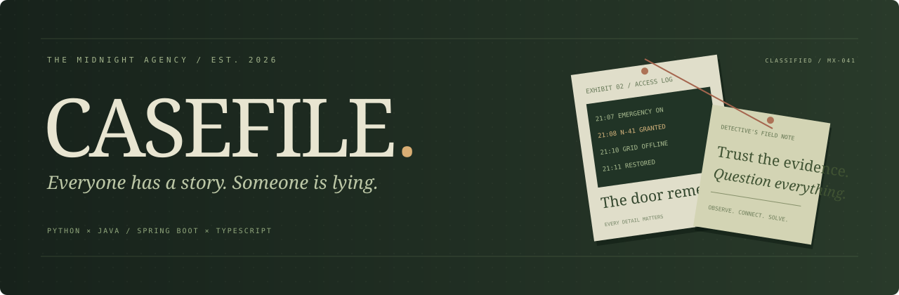
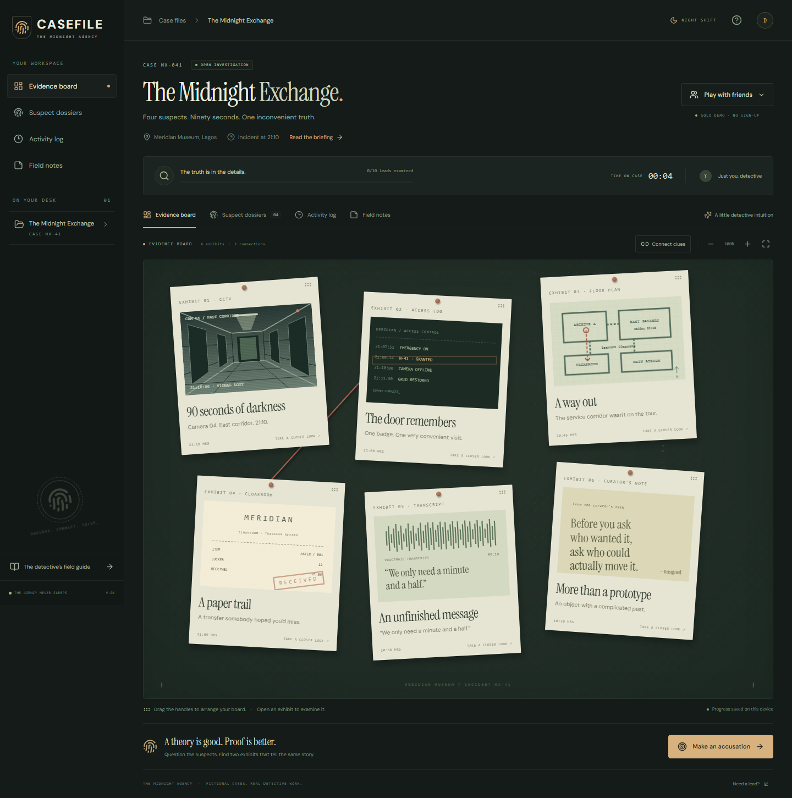
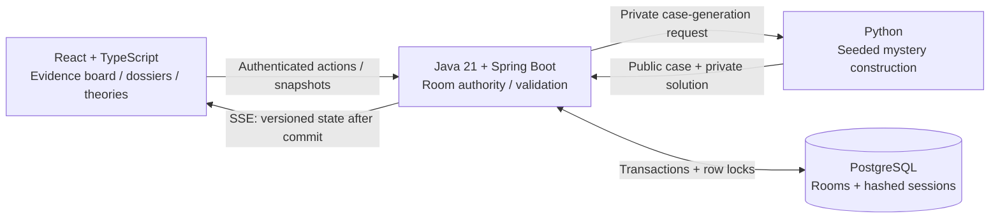

<p align="center"></p>

<p align="center">
  
  
  
  
  
</p>

<p align="center"><b>A multiplayer detective game where the evidence has to agree with your accusation.</b><br />Examine the exhibits. Interview the suspects. Connect the dots. Make your case.</p>

<p align="center"><a href="#try-the-solo-demo">Play the solo demo</a> · <a href="#run-the-whole-agency">Run multiplayer</a> · <a href="docs/architecture.md">Architecture & tradeoffs</a> · <a href="docs/api.md">API contract</a></p>

---

## Your first assignment

**21:10. Meridian Museum, Lagos.** The lights go out. Ninety seconds later, the Aster prototype is gone.

Four people had access. Everyone has an alibi. The security system remembers a badge. The cloakroom remembers a locker. And someone would very much like you to stop asking questions.

Welcome to **The Midnight Exchange**, the first CASEFILE investigation. The museum, characters, and incident are fictional.

## Take a look



## What you can do

- **Work the board.** Open six exhibits, read original records, drag cards by their handles, and connect related clues with thread. Arrow keys also move card handles.
- **Question everyone.** Four illustrated dossiers contain access badges, locker assignments, motives, and interview transcripts.
- **Build a theory together.** Private rooms support up to eight detectives. Evidence, interviews, notes, connections, and activity synchronize over Server-Sent Events.
- **Show your work.** An accusation needs an interviewed suspect and exactly two examined exhibits. The right suspect with the wrong proof does not win.
- **Live with your decisions.** Three unsupported accusations close the case as unresolved. A final report explains the evidence.
- **Pick up where you left off.** Solo progress lives in local storage. Multiplayer state lives in SQL; the current browser tab retains its room session.

## Two ways to play

| | Solo demo | Multiplayer |
|---|---|---|
| Runs on | Static TypeScript frontend | Frontend + Java API + Python engine + SQL |
| Case | Curated seed `41` | Reproducible seeded culprit variants |
| Persistence | Browser local storage | PostgreSQL, or file-backed H2 locally |
| Answer validation | Local demo adapter | Server authority; private solution never sent before closure |
| Team updates | Single player | Authenticated SSE with snapshot recovery |

The standalone frontend runs **solo mode**. Team play requires the services below. The solo fixture contains its solution in the downloaded JavaScript; it is a convenient playable preview, not a secure competitive mode.

The generator currently supports one authored mystery with four culprit variants, consistent evidence, and a unique-solution constraint check. Different seeds can produce the same variant. It does not claim to generate unlimited original stories.

## Try the solo demo

From the project directory, with Node 24+ installed:

```sh
npm ci
npm run build
npm run preview
```

Open the Local URL printed by Vite. No backend or sign-up is needed for the solo case. On the prepared local checkout, the dependencies and production build already exist, so `npm run preview` is enough.

## Run the whole agency

With Docker and Compose installed:

```sh
docker compose up --build
```

Open **http://localhost:8088**. Choose **Play with friends → Create a room**, enter a detective name, and share the six-letter code. Open another browser or private window to join. The default port is bound to your local machine.

Compose starts Nginx, Spring Boot, the private Python engine, and PostgreSQL. Database data persists in the `casefile-data` volume. Default credentials are for local development; set `DATABASE_PASSWORD` and `GENERATOR_SECRET` before hosting the stack.

### Run services individually

Prerequisites: **Node 24+**, **Java 21**, **Maven 3.9+**, and **Python 3.11+**. Python uses only the standard library. No API key or paid service is needed.

Terminal 1 — case generation:

```sh
cd generator
python server.py
```

Terminal 2 — game authority:

```sh
cd backend
mvn spring-boot:run
```

Terminal 3 — interface, from the repository root:

```sh
npm ci
npm run dev
```

Open **http://localhost:5173**. Vite proxies `/api` to Spring Boot on port `8080`. Python listens on `8001`; Spring Boot uses file-backed H2 unless the `postgres` profile is enabled.

To try just the solo interface, run the npm commands only.

### Build the interface

```sh
npm run build
npm run preview
```

The static output is `dist/`. For an independently hosted API, set `VITE_API_URL` at build time and allow the frontend origin through `CORS_ORIGINS`. Team play over HTTPS needs an HTTPS API. See [.env.example](.env.example).

## Under the hood



**Python constructs the mystery.** A seeded generator selects a culprit, writes matching records and statements, and intersects independent access/custody constraints to reject ambiguous output.

**Java owns the rules.** It creates rooms, hashes bearer tokens, keeps solutions private, serializes room mutations with database row locks, deduplicates request IDs, and only broadcasts committed state.

**TypeScript makes investigation tangible.** The interface renders typed case data, merges snapshots by version, reconnects broken streams, and separates its browser-only demo adapter from the real API client.

## Engineering decisions worth discussing

| Problem | Decision | Tradeoff |
|---|---|---|
| Two detectives act simultaneously | Pessimistic SQL row lock per room | Simple correctness; a busy room serializes writes |
| A request is retried | Persist `requestId` with the room mutation | Idempotent retries; each room has a bounded action history |
| An event arrives out of order | Client accepts only equal/newer versions | Prevents stale state replacing newer progress |
| A transaction rolls back | Publish state only in `afterCommit` | Users never see a rolled-back discovery |
| A stream disconnects | Refresh snapshot, then reconnect with backoff | Recovery without a durable event broker |
| Someone guesses the answer | Require two validated exhibits and an interview | Evidence-based game rules rather than name matching |
| An AI-generated mystery contradicts itself | Use deterministic authored constraints | Reliable, testable cases; less narrative variety |

Read the [architecture notes](docs/architecture.md) for persistence boundaries, SSE limitations, and what changes when the API runs on multiple instances.

## Checks

```sh
# TypeScript game rules
npm test

# Typecheck and production build
npm run build

# Browser flows, including mobile and a complete solution
npx playwright install chromium
npm run test:e2e

# Java HTTP, persistence, authorization, retries, and concurrent actions
cd backend
mvn verify

# From repository root: generator consistency across 500 seeds
python -m unittest discover -s generator -v
```

GitHub Actions defines separate frontend, Java, and Python jobs. The browser suite also captures the board screenshot above. Local verification results and environment limits are recorded in [docs/verification.md](docs/verification.md).

The multiplayer browser test is opt-in. With Python on `8001` and Spring Boot on `8080`, set `CASEFILE_LIVE_TEST=true` before running `npm run test:e2e`. It opens two isolated browser sessions and verifies room creation, joining, live discoveries, shared notes, and reconnecting after a refresh. `CASEFILE_API_PROXY` changes the proxy target when your API uses a different port. To test an already running frontend, set `CASEFILE_TEST_SERVER` to its URL.

## A 90-second walkthrough

1. Open an exhibit and compare its original record with the summary.
2. Switch to **Suspect dossiers**, open a suspect, and conduct an interview.
3. Return to the board and connect two related exhibits.
4. Add a field note. Refresh to demonstrate persistence.
5. Run the backend, create a room, and join from another browser. Watch a teammate's discovery appear.
6. Submit a suspect plus two supporting exhibits and inspect the case report.

## Repository map

```text
casefile/
├── src/                  React interface, API/SSE client, solo rules
├── backend/              Spring Boot authority, Flyway migration, integration tests
├── generator/            Python case construction, private HTTP service, tests
├── shared/               Curated demo fixture and test contract
├── tests/                Playwright browser scenarios
├── deploy/               Nginx API/SSE reverse proxy
├── docs/                 Screenshots, architecture, API, verification
└── compose.yml           Complete local stack
```

## Boundaries

This is a portfolio-scale cooperative game. Room codes enable joining; bearer tokens scope subsequent actions to that room. It does not implement account recovery, public matchmaking, chat moderation, distributed SSE fan-out, or an operations team. Before a public multiplayer launch, add room expiration, rate limiting, admission controls, deployment secrets, and a deliberate retention policy. The [deployment notes](docs/architecture.md#deployment-boundaries) explain those choices.

Custom illustrations and interface assets are included. Self-hosted DM Sans and Instrument Serif fonts retain their SIL Open Font License files in `public/fonts/`. Icons are from Lucide. Code is [MIT licensed](LICENSE).

<p align="center"><sub>OBSERVE. CONNECT. SOLVE.</sub></p>
